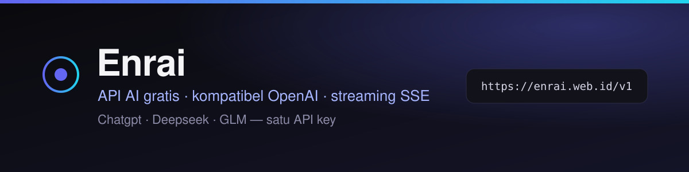
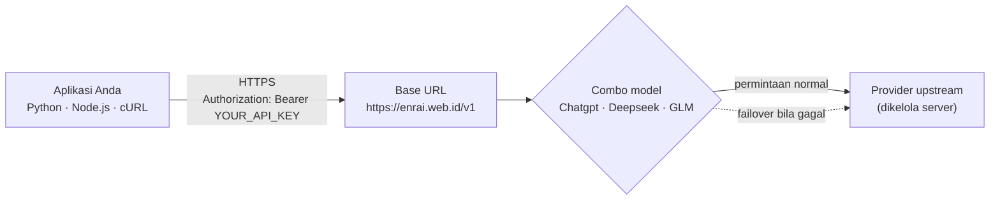

<div align="center">



### API AI gratis untuk developer — satu key, banyak model, kompatibel OpenAI

<p><a href="README.md">English</a> · <b>Bahasa Indonesia</b></p>

[**Daftar gratis**](https://enrai.web.id/register) · [**Dokumentasi**](https://enrai.web.id/docs) · [**Harga & limit**](https://enrai.web.id/pricing) · [**Blog**](https://enrai.web.id/blog)

</div>

[](https://enrai.web.id)
[](https://enrai.web.id/pricing)
[](https://enrai.web.id/docs)
[](https://enrai.web.id/docs)
[](https://enrai.web.id)
[](LICENSE)
[](https://github.com/enraidev/enrai-free-ai-api/actions/workflows/ci.yml)

# Enrai: API AI Gratis untuk Developer (OpenAI-Compatible)

**Enrai** adalah **API AI gratis** yang menyediakan **LLM API** lewat REST API
**kompatibel OpenAI**: satu API key untuk beberapa model, endpoint `/v1/chat/completions` dan
`/v1/models`, plus streaming SSE. Karena format request dan response sama dengan OpenAI,
**SDK OpenAI, klien kompatibel OpenAI, atau tools alternatif ChatGPT** tetap bekerja tanpa menulis
ulang kode — cukup ganti base URL.

Dokumentasi ini ditulis untuk developer yang ingin mengirim request pertama dalam tiga langkah,
lalu tahu persis apa yang terjadi saat gagal: kode error, batas laju, dan cara menanganinya.

> Versi bahasa Inggris (utama): [`README.md`](README.md). Dokumentasi teknis terjemahan ada di
> [`docs/id/`](docs/id/getting-started.md).

---

## Daftar isi

- [Fitur utama](#fitur-utama)
- [Kenapa Enrai?](#kenapa-enrai)
- [Arsitektur](#arsitektur)
- [Model yang tersedia](#model-yang-tersedia)
- [Batas pemakaian (rate limit)](#batas-pemakaian-rate-limit)
- [Quick start: 3 langkah](#quick-start-3-langkah)
- [Contoh kode](#contoh-kode)
- [Penanganan error & retry](#penanganan-error--retry)
- [Use case](#use-case)
- [FAQ](#faq)
- [Dokumentasi lengkap](#dokumentasi-lengkap)
- [Berkontribusi](#berkontribusi)
- [Lisensi](#lisensi)

---

## Fitur utama

- **Endpoint kompatibel OpenAI** — `POST /v1/chat/completions` dan `GET /v1/models`; SDK OpenAI
  (Python, Node.js), Postman, dan tools lain jalan hanya dengan mengganti base URL.
- **Satu key untuk semua model** — key dibuat sekali di dashboard, dipakai untuk seluruh model
  yang tersedia.
- **Gratis tanpa kartu kredit** — tier gratis selama **public beta**, dengan limit yang
  dipublikasikan di [halaman harga](https://enrai.web.id/pricing).
- **Streaming SSE** — kirim `"stream": true`, terima potongan jawaban real-time, diakhiri
  `[DONE]`.
- **Failover antar provider** — setiap nama model adalah *combo* yang dikelola server; permintaan
  yang gagal diulang ke anggota combo lain.
- **Daftar model dinamis** — `GET /v1/models` mengembalikan model yang benar-benar aktif, sehingga
  nama model tidak perlu di-hardcode.
- **Error yang bisa ditindaklanjuti** — `401`, `429`, `500`, `502` dengan pesan di `error.message`.

## Kenapa Enrai?

- **Mulai tanpa biaya dan tanpa kartu kredit.** Cocok untuk prototipe, demo, dan tools internal
  sebelum Anda memutuskan provider berbayar.
- **Tidak perlu memilih provider.** Satu nama model (`Chatgpt`, `Deepseek`, `GLM`) bisa dilayani
  beberapa provider; kombinasi dan failover diurus server.
- **Tidak mengunci kode Anda.** Semua contoh memakai format OpenAI. Pindah provider = ganti
  `base_url` dan `api_key`.
- **Limitnya jelas, bukan misteri.** Angka rate limit dipublikasikan, dan error `429` punya arti
  yang spesifik.

## Arsitektur



Yang bisa diverifikasi dari dokumentasi publik: aplikasi memanggil satu base URL dengan API key,
nama model adalah alias combo, dan permintaan diulang ke anggota combo lain bila provider gagal.
Nama provider individual tidak dipublikasikan.

## Model yang tersedia

Daftar mengikuti beranda [enrai.web.id](https://enrai.web.id) per **17 November 2026**. Status
terbaru ada di [bagian model beranda](https://enrai.web.id/#model) dan di
`GET https://enrai.web.id/v1/models`.

| Model | Kapabilitas | Streaming | Status |
|---|---|---|---|
| `Chatgpt` | Chat completion | Ya | Online |
| `Deepseek` | Chat completion | Ya | Online |
| `GLM` | Chat completion | Ya | Online |

> Nama model adalah **alias combo**, bukan nama vendor. Detail dan catatan kapabilitas lain:
> [`docs/id/models.md`](docs/id/models.md).

## Batas pemakaian (rate limit)

| Endpoint | Limit per API key |
|---|---|
| `POST /v1/chat/completions` | 20 request/menit (burst 5) |
| `GET /v1/models` | 60 request/menit |

Angka ini berasal dari [halaman harga](https://enrai.web.id/pricing) dan
[dokumentasi API](https://enrai.web.id/docs) per 17 November 2026. Cache daftar model saat
aplikasi start; jangan memanggil `/v1/models` di setiap request.

## Quick start: 3 langkah

1. **Daftar gratis** — [enrai.web.id/register](https://enrai.web.id/register), tanpa kartu kredit.
2. **Ambil API key** — Dashboard → **API Keys**. Key ditampilkan **sekali**; simpan sebagai
   environment variable.
3. **Kirim request pertama** — pakai salah satu contoh di bawah dengan base URL
   `https://enrai.web.id/v1`.

## Contoh kode

Placeholder `YOUR_API_KEY` diganti key Anda. Semua contoh versi repo membaca environment variable
`ENRAI_API_KEY`.

### cURL

```bash
curl https://enrai.web.id/v1/chat/completions \
  -H "Authorization: Bearer YOUR_API_KEY" \
  -H "Content-Type: application/json" \
  -d '{
    "model": "Chatgpt",
    "messages": [
      { "role": "user", "content": "Halo! Jelaskan API AI gratis dalam satu paragraf." }
    ]
  }'
```

### Python

```bash
pip install openai
```

```python
import os
from openai import OpenAI

client = OpenAI(
    base_url="https://enrai.web.id/v1",
    api_key=os.environ["ENRAI_API_KEY"],
)

response = client.chat.completions.create(
    model="Chatgpt",
    messages=[{"role": "user", "content": "Halo! Apa itu API yang kompatibel OpenAI?"}],
)

print(response.choices[0].message.content)
```

### JavaScript / Node.js

```bash
npm install openai
```

```javascript
import OpenAI from "openai";

const client = new OpenAI({
  baseURL: "https://enrai.web.id/v1",
  apiKey: process.env.ENRAI_API_KEY,
});

const response = await client.chat.completions.create({
  model: "Chatgpt",
  messages: [{ role: "user", content: "Halo! Apa itu API yang kompatibel OpenAI?" }],
});

console.log(response.choices[0].message.content);
```

<details>
<summary><strong>Streaming dengan Python</strong> (Server-Sent Events)</summary>

```python
import os
from openai import OpenAI

client = OpenAI(base_url="https://enrai.web.id/v1", api_key=os.environ["ENRAI_API_KEY"])

stream = client.chat.completions.create(
    model="Chatgpt",
    messages=[{"role": "user", "content": "Tulis paragraf singkat tentang API."}],
    stream=True,
)

for chunk in stream:
    if chunk.choices and chunk.choices[0].delta.content:
        print(chunk.choices[0].delta.content, end="", flush=True)
print()
```

Versi lengkap dengan penanganan error: [`examples/python/stream.py`](examples/python/stream.py).

</details>

<details>
<summary><strong>Streaming dengan Node.js</strong> (tanpa dependency)</summary>

```javascript
const res = await fetch("https://enrai.web.id/v1/chat/completions", {
  method: "POST",
  headers: {
    Authorization: `Bearer ${process.env.ENRAI_API_KEY}`,
    "Content-Type": "application/json",
    Accept: "text/event-stream",
  },
  body: JSON.stringify({
    model: "Chatgpt",
    stream: true,
    messages: [{ role: "user", content: "Hitung 1 sampai 10." }],
  }),
});

const reader = res.body.getReader();
const decoder = new TextDecoder();
let buffer = "";

for (;;) {
  const { value, done } = await reader.read();
  if (done) break;
  buffer += decoder.decode(value, { stream: true });

  const lines = buffer.split("\n");
  buffer = lines.pop() ?? "";

  for (const line of lines) {
    if (!line.trim().startsWith("data:")) continue; // abaikan komentar/heartbeat
    const payload = line.trim().slice(5).trim();
    if (payload === "[DONE]") process.exit(0);
    const piece = JSON.parse(payload)?.choices?.[0]?.delta?.content;
    if (piece) process.stdout.write(piece);
  }
}
```

Versi lengkap dengan penanganan error: [`examples/nodejs/chat.mjs`](examples/nodejs/chat.mjs)
(jalankan dengan `--stream`).

Contoh lengkap per bahasa ada di [`examples/`](examples/README.md):
[Python](examples/python/chat.py), [Node.js](examples/nodejs/chat.mjs),
[cURL](examples/curl/chat.sh), [OpenAI SDK](examples/openai-sdk/README.md).

## Penanganan error & retry

| Status | Arti | Yang sebaiknya dilakukan |
|---|---|---|
| `401` | Key hilang atau tidak valid | Periksa header `Authorization: Bearer <key>`; buat ulang key di dashboard bila perlu |
| `429` | Melewati 20 request/menit (burst 5) | Backoff eksponensial dengan jitter, maksimal 3 percobaan; kurangi konkurensi |
| `500` | Galat server | Ulangi setelah jeda; laporkan bila berulang |
| `502` | Semua provider di balik combo gagal | Ulangi setelah beberapa saat — payload biasanya tidak salah |

Dua jebakan yang mudah terlewat:

- **`200` dengan `choices` kosong adalah kegagalan**, bukan sukses. Perlakukan sebagai error dan
  retry sekali.
- **Jangan menaruh `/v1/models` di jalur request** — limitnya 60/menit per key dan hasilnya jarang
  berubah.

Detail lengkap: [`docs/id/api-reference.md`](docs/id/api-reference.md#error).

## Use case

- **Chatbot & asisten** — chatbot web, asisten internal, atau CS sederhana.
- **Otomasi & tooling** — merangkum dokumen, mengekstrak data, menyusun draft konten.
- **Aplikasi mobile & web** — backend yang butuh LLM tanpa biaya per token di tahap awal.
- **Bot Telegram / WhatsApp** — meneruskan pesan masuk ke `/v1/chat/completions` dengan streaming.
- **Belajar & eksperimen** — membandingkan beberapa model dengan satu key dan satu format request.

## FAQ

<details>
<summary><strong>Apakah API AI Enrai benar-benar gratis?</strong></summary>

Ya. Selama **public beta** ada tier gratis tanpa kartu kredit, dengan limit yang dipublikasikan di
[halaman harga](https://enrai.web.id/pricing).

</details>

<details>
<summary><strong>Apakah kompatibel dengan OpenAI SDK?</strong></summary>

Ya. Ganti `baseURL` menjadi `https://enrai.web.id/v1` dan pakai API key Enrai; bentuk request,
response, dan streaming mengikuti format OpenAI.

</details>

<details>
<summary><strong>Model apa saja yang tersedia?</strong></summary>

`Chatgpt`, `Deepseek`, dan `GLM`. `GET /v1/models` selalu menjadi daftar terbaru — cache hasilnya
saat start.

</details>

<details>
<summary><strong>Berapa rate limit-nya?</strong></summary>

20 request/menit untuk chat completion (burst 5) dan 60 request/menit untuk daftar model, per API
key.

</details>

<details>
<summary><strong>Apakah streaming didukung?</strong></summary>

Ya. Kirim `"stream": true`; response berupa Server-Sent Events dan diakhiri `[DONE]`.

</details>

<details>
<summary><strong>Bahasa pemrograman apa yang didukung?</strong></summary>

Apa pun yang punya HTTP client: Python, JavaScript/Node.js, PHP, Go, Rust, Java, Kotlin. Kalau
bahasanya punya SDK OpenAI, SDK itu bisa dipakai langsung.

</details>

<details>
<summary><strong>Apakah ada vision atau function calling?</strong></summary>

Belum dipublikasikan di dokumentasi resmi. Jangan merancang fitur yang bergantung pada kemampuan
ini sampai tercantum di [enrai.web.id/docs](https://enrai.web.id/docs).

</details>

<details>
<summary><strong>Apakah aman untuk produksi?</strong></summary>

Statusnya **public beta** — cocok untuk prototipe dan tools internal. Untuk layanan kritis,
siapkan provider kedua sebagai fallback; karena formatnya OpenAI, berpindah hanya mengganti base
URL dan key.

</details>

Pertanyaan lain: [`docs/id/faq.md`](docs/id/faq.md).

## Dokumentasi lengkap

| Dokumen | Isi |
|---|---|
| [`docs/id/getting-started.md`](docs/id/getting-started.md) | Daftar, ambil key, request pertama, troubleshooting |
| [`docs/id/api-reference.md`](docs/id/api-reference.md) | Endpoint, autentikasi, streaming, error, rate limit |
| [`docs/id/models.md`](docs/id/models.md) | Model, alias combo, cara cek model aktif |
| [`docs/id/faq.md`](docs/id/faq.md) | Pertanyaan yang sering muncul |
| [`CHANGELOG.md`](CHANGELOG.md) | Riwayat perubahan dokumentasi & contoh |
| [`SECURITY.md`](SECURITY.md) | Cara melaporkan kerentanan |

Referensi resmi: [enrai.web.id/docs](https://enrai.web.id/docs) ·
[Harga & limit](https://enrai.web.id/pricing) · [Blog](https://enrai.web.id/blog)

Halaman status layanan belum dipublikasikan; status model bisa dilihat di
[bagian model beranda](https://enrai.web.id/#model).

## Berkontribusi

Koreksi dokumentasi, contoh kode baru, atau laporan bug sangat diterima. Baca
[`CONTRIBUTING.md`](CONTRIBUTING.md) dan [`CODE_OF_CONDUCT.md`](CODE_OF_CONDUCT.md) lebih dulu.
Jangan pernah menaruh API key di issue, PR, atau commit.

## Lisensi

- **Kode contoh** (`examples/`): [MIT](LICENSE)
- **Dokumentasi & artikel** (`README.md`, `README.id.md`, `docs/`, `articles/`, `index.html`):
  [CC BY 4.0](LICENSE-DOCS.md)
