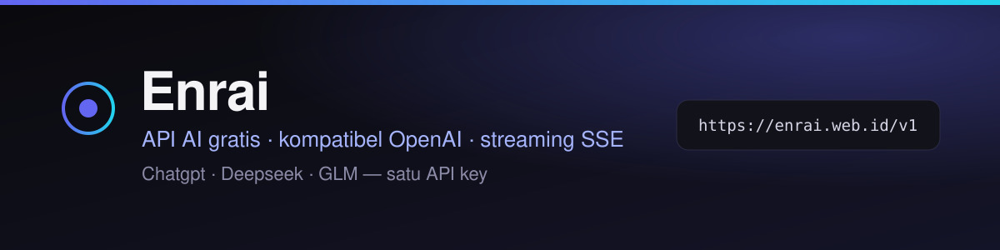
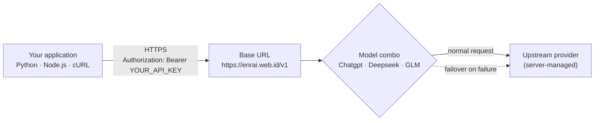

<div align="center">



### Free AI API for developers — one key, several models, OpenAI-compatible

<p><b>English</b> · <a href="README.id.md">Bahasa Indonesia</a></p>

[**Sign up free**](https://enrai.web.id/register) · [**Documentation**](https://enrai.web.id/docs) · [**Pricing & limits**](https://enrai.web.id/pricing) · [**Blog**](https://enrai.web.id/blog)

</div>

[](https://enrai.web.id)
[](https://enrai.web.id/pricing)
[](https://enrai.web.id/docs)
[](https://enrai.web.id/docs)
[](https://enrai.web.id)
[](LICENSE)
[](https://github.com/enraidev/enrai-free-ai-api/actions/workflows/ci.yml)

# Enrai: Free AI API for Developers (OpenAI-Compatible)

**Enrai** is a **free AI API** that exposes an **LLM API** through an **OpenAI-compatible** REST
interface: one API key for several models, the endpoints `/v1/chat/completions` and `/v1/models`,
and SSE streaming. Because the request and response shapes are identical to OpenAI, an **OpenAI
SDK, an OpenAI-compatible client or a ChatGPT-alternative tool** keeps working without a rewrite —
you change the base URL and nothing else.

This documentation is written for developers who want to send their first request in three steps,
and who then want to know exactly what happens when something fails: the error codes, the rate
limits, and how to handle both.

> Bahasa Indonesia (secondary language): [`README.id.md`](README.id.md). Translated technical docs
> live in [`docs/id/`](docs/id/getting-started.md).

---

## Table of contents

- [Key features](#key-features)
- [Why Enrai?](#why-enrai)
- [Architecture](#architecture)
- [Available models](#available-models)
- [Rate limits](#rate-limits)
- [Quick start: 3 steps](#quick-start-3-steps)
- [Code examples](#code-examples)
- [Error handling & retries](#error-handling--retries)
- [Use cases](#use-cases)
- [FAQ](#faq)
- [Documentation index](#documentation-index)
- [Contributing](#contributing)
- [License](#license)
- [Bahasa Indonesia](#bahasa-indonesia)

---

## Key features

- **OpenAI-compatible endpoints** — `POST /v1/chat/completions` and `GET /v1/models`; the OpenAI
  SDK (Python, Node.js), Postman and other OpenAI-shaped tools work after changing the base URL.
- **One key for every model** — create the key once in the dashboard and use it across all
  available models.
- **Free, no credit card** — a free tier during **public beta**, with limits published on the
  [pricing page](https://enrai.web.id/pricing).
- **SSE streaming** — send `"stream": true`, receive answer chunks in real time, terminated by
  `[DONE]`.
- **Provider failover** — each model name is a server-managed *combo*; a failed request is retried
  against another member of the combo.
- **Dynamic model list** — `GET /v1/models` returns the models that are actually live, so names
  never need to be hardcoded.
- **Actionable errors** — `401`, `429`, `500`, `502` with a message in `error.message`.

## Why Enrai?

- **Start for free, no credit card.** Good for prototypes, demos and internal tools before you
  commit to a paid provider.
- **No provider shopping.** A single model name (`Chatgpt`, `Deepseek`, `GLM`) can be served by
  several upstream providers; the combination and the failover are handled server-side.
- **No lock-in in your code.** Every example uses the OpenAI format. Moving away means changing
  `base_url` and `api_key`.
- **Limits in writing, not a mystery.** Rate limits are published, and a `429` has a specific
  meaning you can code against.

## Architecture



What the public documentation can verify: the application calls one base URL with an API key, the
model name is a combo alias, and a request is retried against another combo member when a provider
fails. Individual provider names are not published.

## Available models

The list follows the [enrai.web.id](https://enrai.web.id) home page as of **17 November 2026**.
Live status is on the [home page model section](https://enrai.web.id/#model) and at
`GET https://enrai.web.id/v1/models`.

| Model | Capability | Streaming | Status |
|---|---|---|---|
| `Chatgpt` | Chat completion | Yes | Online |
| `Deepseek` | Chat completion | Yes | Online |
| `GLM` | Chat completion | Yes | Online |

> Model names are **combo aliases**, not vendor names. Details and other capability notes:
> [`docs/models.md`](docs/models.md).

## Rate limits

| Endpoint | Limit per API key |
|---|---|
| `POST /v1/chat/completions` | 20 requests per minute (burst 5) |
| `GET /v1/models` | 60 requests per minute |

These numbers come from the [pricing page](https://enrai.web.id/pricing) and the
[API documentation](https://enrai.web.id/docs) as of 17 November 2026. Cache the model list when
your application starts; do not call `/v1/models` on every request.

## Quick start: 3 steps

1. **Sign up free** — [enrai.web.id/register](https://enrai.web.id/register), no credit card.
2. **Get an API key** — Dashboard → **API Keys**. The key is shown **once**; store it as an
   environment variable.
3. **Send your first request** — use any example below with the base URL
   `https://enrai.web.id/v1`.

## Code examples

Replace the `YOUR_API_KEY` placeholder with your own key. Every example in this repository reads
the `ENRAI_API_KEY` environment variable.

### cURL

```bash
curl https://enrai.web.id/v1/chat/completions \
  -H "Authorization: Bearer YOUR_API_KEY" \
  -H "Content-Type: application/json" \
  -d '{
    "model": "Chatgpt",
    "messages": [
      { "role": "user", "content": "Hello! Explain a free AI API in one paragraph." }
    ]
  }'
```

### Python

```bash
pip install openai
```

```python
import os
from openai import OpenAI

client = OpenAI(
    base_url="https://enrai.web.id/v1",
    api_key=os.environ["ENRAI_API_KEY"],
)

response = client.chat.completions.create(
    model="Chatgpt",
    messages=[{"role": "user", "content": "Hello! What is an OpenAI-compatible API?"}],
)

print(response.choices[0].message.content)
```

### JavaScript / Node.js

```bash
npm install openai
```

```javascript
import OpenAI from "openai";

const client = new OpenAI({
  baseURL: "https://enrai.web.id/v1",
  apiKey: process.env.ENRAI_API_KEY,
});

const response = await client.chat.completions.create({
  model: "Chatgpt",
  messages: [{ role: "user", content: "Hello! What is an OpenAI-compatible API?" }],
});

console.log(response.choices[0].message.content);
```

<details>
<summary><strong>Streaming with Python</strong> (Server-Sent Events)</summary>

```python
import os
from openai import OpenAI

client = OpenAI(base_url="https://enrai.web.id/v1", api_key=os.environ["ENRAI_API_KEY"])

stream = client.chat.completions.create(
    model="Chatgpt",
    messages=[{"role": "user", "content": "Write a short paragraph about APIs."}],
    stream=True,
)

for chunk in stream:
    if chunk.choices and chunk.choices[0].delta.content:
        print(chunk.choices[0].delta.content, end="", flush=True)
print()
```

Full version with error handling: [`examples/python/stream.py`](examples/python/stream.py).

</details>

<details>
<summary><strong>Streaming with Node.js</strong> (no dependencies)</summary>

```javascript
const res = await fetch("https://enrai.web.id/v1/chat/completions", {
  method: "POST",
  headers: {
    Authorization: `Bearer ${process.env.ENRAI_API_KEY}`,
    "Content-Type": "application/json",
    Accept: "text/event-stream",
  },
  body: JSON.stringify({
    model: "Chatgpt",
    stream: true,
    messages: [{ role: "user", content: "Count from 1 to 10." }],
  }),
});

const reader = res.body.getReader();
const decoder = new TextDecoder();
let buffer = "";

for (;;) {
  const { value, done } = await reader.read();
  if (done) break;
  buffer += decoder.decode(value, { stream: true });

  const lines = buffer.split("\n");
  buffer = lines.pop() ?? "";

  for (const line of lines) {
    if (!line.trim().startsWith("data:")) continue; // skip comments/heartbeats
    const payload = line.trim().slice(5).trim();
    if (payload === "[DONE]") process.exit(0);
    const piece = JSON.parse(payload)?.choices?.[0]?.delta?.content;
    if (piece) process.stdout.write(piece);
  }
}
```

Full version with error handling: [`examples/nodejs/chat.mjs`](examples/nodejs/chat.mjs) (run it
with `--stream`).

Complete per-language examples live in [`examples/`](examples/README.md):
[Python](examples/python/chat.py), [Node.js](examples/nodejs/chat.mjs),
[cURL](examples/curl/chat.sh), [OpenAI SDK](examples/openai-sdk/README.md).

## Error handling & retries

| Status | Meaning | What to do |
|---|---|---|
| `401` | Missing or invalid key | Check the `Authorization: Bearer <key>` header; create a new key in the dashboard if needed |
| `429` | Over 20 requests/minute (burst 5) | Exponential backoff with jitter, at most 3 attempts; reduce concurrency |
| `500` | Server error | Retry after a pause; report it if it repeats |
| `502` | Every provider behind the combo failed | Retry after a short wait — your payload is usually not at fault |

Two traps that are easy to miss:

- **A `200` with empty `choices` is a failure**, not a success. Treat it as an error and retry
  once.
- **Keep `/v1/models` out of the request path** — it is limited to 60 requests/minute per key and
  its result rarely changes.

Full detail: [`docs/api-reference.md`](docs/api-reference.md#error).

## Use cases

- **Chatbots & assistants** — web chatbots, internal assistants or simple customer support.
- **Automation & tooling** — summarising documents, extracting data, drafting content.
- **Mobile & web apps** — backends that need an LLM without per-token cost in the early stage.
- **Telegram / WhatsApp bots** — forward incoming messages to `/v1/chat/completions` with
  streaming.
- **Learning & experiments** — compare several models with one key and one request format.

## FAQ

<details>
<summary><strong>Is the Enrai AI API really free?</strong></summary>

Yes. During **public beta** there is a free tier with no credit card, and the limits are published
on the [pricing page](https://enrai.web.id/pricing).

</details>

<details>
<summary><strong>Is it compatible with the OpenAI SDK?</strong></summary>

Yes. Point `baseURL` at `https://enrai.web.id/v1` and use an Enrai API key; the request, response
and streaming shapes follow the OpenAI format.

</details>

<details>
<summary><strong>Which models are available?</strong></summary>

`Chatgpt`, `Deepseek` and `GLM`. `GET /v1/models` is always the current list — cache it at
startup.

</details>

<details>
<summary><strong>What are the rate limits?</strong></summary>

20 requests per minute for chat completions (burst 5) and 60 requests per minute for the model
list, per API key.

</details>

<details>
<summary><strong>Is streaming supported?</strong></summary>

Yes. Send `"stream": true`; the response is Server-Sent Events and ends with `[DONE]`.

</details>

<details>
<summary><strong>Which programming languages are supported?</strong></summary>

Anything with an HTTP client: Python, JavaScript/Node.js, PHP, Go, Rust, Java, Kotlin. If the
language has an OpenAI SDK, that SDK works as-is.

</details>

<details>
<summary><strong>Is vision or function calling available?</strong></summary>

Not published in the official documentation yet. Do not design features that depend on those
capabilities until they appear at [enrai.web.id/docs](https://enrai.web.id/docs).

</details>

<details>
<summary><strong>Is it production-ready?</strong></summary>

The service is in **public beta** — suitable for prototypes and internal tools. For critical
services, keep a second provider as a fallback; because the format is OpenAI's, switching means
changing the base URL and the key.

</details>

More questions: [`docs/faq.md`](docs/faq.md).

## Documentation index

| Document | Contents |
|---|---|
| [`docs/getting-started.md`](docs/getting-started.md) | Sign up, get a key, first request, troubleshooting |
| [`docs/api-reference.md`](docs/api-reference.md) | Endpoints, authentication, streaming, errors, rate limits |
| [`docs/models.md`](docs/models.md) | Models, combo aliases, checking which models are live |
| [`docs/faq.md`](docs/faq.md) | Frequently asked questions |
| [`CHANGELOG.md`](CHANGELOG.md) | Documentation and example history |
| [`SECURITY.md`](SECURITY.md) | How to report a vulnerability |

Official references: [enrai.web.id/docs](https://enrai.web.id/docs) ·
[Pricing & limits](https://enrai.web.id/pricing) · [Blog](https://enrai.web.id/blog)

No public status page yet; model status is visible on the
[home page model section](https://enrai.web.id/#model).

## Contributing

Documentation corrections, new code examples and bug reports are welcome. Read
[`CONTRIBUTING.md`](CONTRIBUTING.md) and [`CODE_OF_CONDUCT.md`](CODE_OF_CONDUCT.md) first. Never put
an API key in an issue, a pull request or a commit.

## License

- **Example code** (`examples/`): [MIT](LICENSE)
- **Documentation and articles** (`README.md`, `README.id.md`, `docs/`, `articles/`, `index.html`,
  `index.id.html`): [CC BY 4.0](LICENSE-DOCS.md)

---

## Bahasa Indonesia

This repository ships in two languages: **English** (primary) and **Indonesian** (secondary). The
full Indonesian version is [`README.id.md`](README.id.md), with translated technical docs under
[`docs/id/`](docs/id/getting-started.md).

**Enrai** adalah **API AI gratis** untuk developer: satu API key untuk beberapa model
(`Chatgpt`, `Deepseek`, `GLM`), REST API **kompatibel OpenAI**
(`POST /v1/chat/completions`, `GET /v1/models`) dengan streaming SSE dan failover provider
otomatis. Arahkan SDK OpenAI Anda ke `https://enrai.web.id/v1` tanpa mengubah kode lain.

- **Tier gratis tanpa kartu kredit** selama public beta — [daftar](https://enrai.web.id/register)
- **Rate limit:** 20 request chat/menit (burst 5) dan 60 request daftar model/menit per key
- **Dokumentasi:** [enrai.web.id/docs](https://enrai.web.id/docs) · **Harga:**
  [enrai.web.id/pricing](https://enrai.web.id/pricing)
- **Contoh kode:** [Python](examples/python/chat.py), [Node.js](examples/nodejs/chat.mjs),
  [cURL](examples/curl/chat.sh), [OpenAI SDK](examples/openai-sdk/README.md)
- **Halaman status:** belum dipublikasikan; status model live ada di
  [beranda](https://enrai.web.id/#model)
